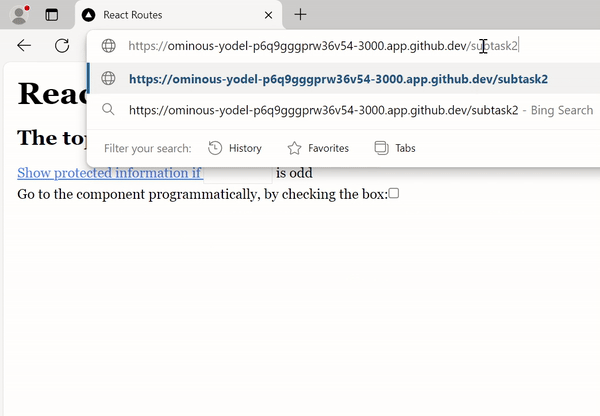
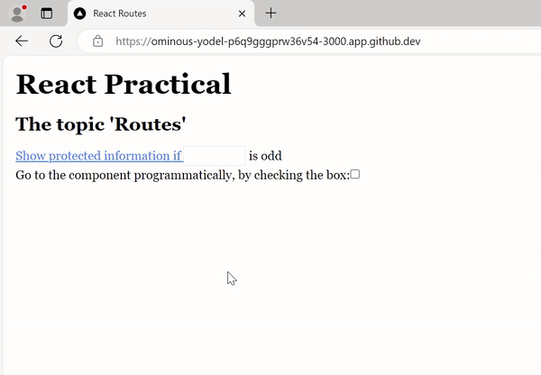

# Advanced Frontend with React.js

## Topic: Routes

This starter is a **Next.js App Router** app. Implement the routes below with Next.js routing APIs. Do not add `react-router-dom`.

The start screen looks like this:

<kbd>
  
</kbd>

The headings, the **Show protected information if** link, the number input, and the checkbox must stay visible on every route you add. Only the extra content of each subtask should appear after navigation.

Exact text in the examples matters: tests look for these strings inside a `div`.

### Getting started

Use **Node 20** or newer.

```bash
npm install
npm run dev
```

Open [http://localhost:3000](http://localhost:3000).

To check your solution the same way CI does:

```bash
npm run e2e:headless
```

(`npm run e2e` opens the Cypress UI.)

---

### Subtask 1 — path parameter

Create the path `/subtask1` with a parameter.

After opening this path, render a `div` with the text `Subtask1, parameter:` and the parameter value.

Example: `/subtask1/2` shows `Subtask1, parameter: 2`.

<kbd>
  
</kbd>

### Subtask 2 — query parameters

Create the path `/subtask2` that reads the query string.

After opening this path, render a `div` with the text `Subtask2, query parameters:` followed by every query pair in URL order, separated by a comma and a space. Keep each pair as `key=value`.

Example: `/subtask2?author=alan&age=20` shows `Subtask2, query parameters: author=alan, age=20`.

<kbd>
  
</kbd>

### Subtask 3 — guarded route

Create the path `/subtask3`. Access to the protected content depends on the number input on the start screen.

- Click **Show protected information if** while the number is **odd**: the app navigates to `/subtask3` and renders a `div` with `Subtask3, protected information`.
- Click the same link while the number is missing or **even**: the protected text must not appear.
- Opening `/subtask3` from the address bar without an odd number must not show the protected text.
- If the number is no longer odd, the protected text must disappear.

<kbd>
  
</kbd>

### Subtask 4 — programmatic navigation

Create the path `/subtask4`. It must work both from the address bar and from the UI.

Checking the checkbox navigates to `/subtask4`. After that, render a `div` with `Subtask4, navigated programmatically`.

Opening `/subtask4` directly in the address bar must show the same content.

<kbd>
  
</kbd>
